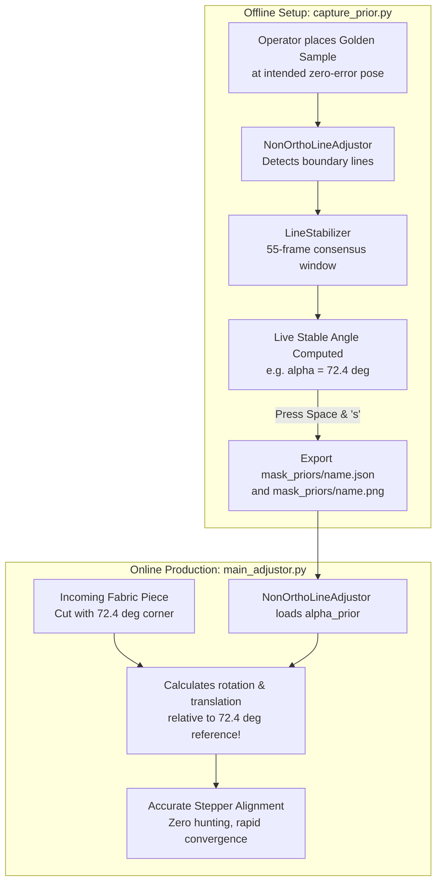

# Reference Prior & Angle Capture Tool (`capture_prior.py`)

## 1. Overview & Operational Role

[`capture_prior.py`](file:///d:/ai-sewing/capture_prior.py) is an interactive calibration and template acquisition utility. It allows sewing technicians to place a reference "golden sample" fabric piece onto the table and record its baseline geometric properties before starting production runs.

---

## 2. Why `capture_prior` is Critical (The Non-Orthogonal Geometry Rationale)

In standard industrial automation, visual adjustors frequently assume rigid Cartesian geometry:
* Two detected outer boundary lines are assumed to intersect at exactly **$90.0^\circ$**.
* The axes are assumed parallel to the horizontal ($\mathbf{u}_1$) and vertical ($\mathbf{u}_2$) carriage rails.

### The Real-World Sewing Manufacturing Problem
In apparel and technical textile manufacturing, garment pattern pieces are rarely simple rectangles:
* **Garment Contours**: Collar points, lapels, shirt yokes, sleeve caps, and gussets are cut with acute ($< 90^\circ$) or obtuse ($> 90^\circ$) corner angles (e.g. $65^\circ$, $110^\circ$, $135^\circ$).
* **Failure of Rigid Assumptions**: If an orthogonal adjustor attempts to align an $80^\circ$ collar corner, it will continuously penalize the $10^\circ$ angular deviation, calculating false rotation corrections, causing endless motor hunting, and failing to converge.
* **The Solution**: `capture_prior.py` solves this by recording the piece's intrinsic golden baseline:
  1. It measures the physical corner angle $\alpha_{\text{prior}}$ from a stabilized reference sample.
  2. It saves this reference angle to `mask_priors/<name>.json`.
  3. During production, [`NonOrthoLineAdjustor`](modules_fabric_adjustor.md) loads this prior angle $\alpha_{\text{prior}}$, allowing closed-loop servoing to align non-orthogonal fabric pieces with sub-millimeter precision!



---

## 3. Operating Modes & CLI Flags

```bash
python capture_prior.py --mode line
# or
python capture_prior.py --mode edge
```

### 3.1 Line Mode (`--mode line`, Default)
* **Target Backend**: Mobile-LSD neural line detection (`DetectorMode.MLSD`).
* **Live Angle Stabilization**:
  Instantiates `LineStabilizer(window=55)`:
  * Collects horizontal and vertical line candidates across 55 video frames.
  * Calculates the enclosed corner angle:
    $$\theta_1 = \operatorname{arctan2}(\Delta y_1, \Delta x_1), \quad \theta_2 = \operatorname{arctan2}(\Delta y_2, \Delta x_2)$$
    $$\Delta\theta = |\theta_1 - \theta_2| \pmod{180^\circ}$$
    $$\text{If } \Delta\theta > 90^\circ \implies \alpha = 180^\circ - \Delta\theta$$
  * Displays the live smoothed corner angle on the video HUD: `Live Stable Angle: XX.X°`.

### 3.2 Edge Mode (`--mode edge`)
* **Target Backend**: DexiNed deep edge detector (`DetectorMode.DEXINED`).
* Captures a reference boundary contour template for contour/moment matching.

---

## 4. Interactive Keyboard Workflow

1. **Alignment Phase**:
   Align the fabric piece corner precisely with the origin crosshair `(DEFAULT_X_BASIS, DEFAULT_Y_BASIS)`.
2. **`Space`**:
   Freezes the current video frame and locks the stabilized corner lines and angle $\alpha_{\text{prior}}$.
3. **Confirmation Window**:
   * Press **`s`** to accept and save.
   * Press **`r`** to discard and retry capture.
   * Press **`q`** to abort.
4. **Naming Prompt**:
   Input a session identifier (e.g. `'collar_v1'`).
5. **Generated Output Artifacts**:
   * `mask_priors/<name>.png`: Full-frame reference image.
   * `mask_priors/<name>.json`: Serialized geometric metadata:
     ```json
     {
         "alpha_prior": 74.35
     }
     ```
