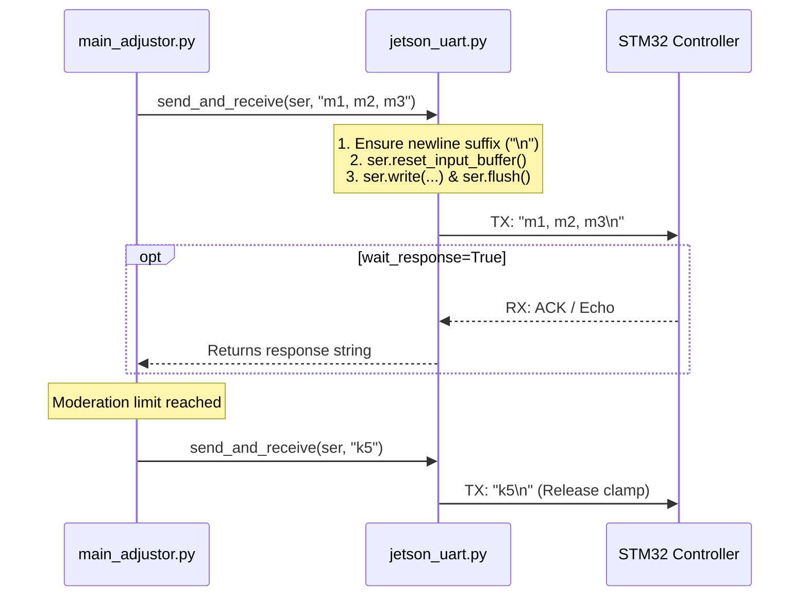

# Jetson UART Serial Communication (`jetson_uart.py`)

## 1. Overview & Architecture

[`jetson_uart.py`](file:///d:/ai-sewing/jetson_uart.py) provides the hardware communication interface between the host NVIDIA Jetson computer and the low-level STM32 microcontroller driving the fabric adjustment motors.

In the fabric adjustor pipeline, [`main_adjustor.py`](file:///d:/ai-sewing/main_adjustor.py) relies exclusively on `send_and_receive(...)` to dispatch real-time motion commands ($M_1, M_2, M_3$), stage release commands (`k5`) and more.



---

## 2. Port Discovery & Hardware Setup

### Port Resolution: `get_default_port()`

The function automatically identifies attached serial converters to allow plug-and-play operation across diverse hardware configurations:

```python
def get_default_port() -> str:
    """Detect USB serial devices first (fallback to /dev/ttyUSB0)."""
    ports = list(serial.tools.list_ports.comports())
    for p in ports:
        if "USB" in p.description or "ACM" in p.device:
            return p.device
    return "/dev/ttyUSB0"
```

* **USB-to-UART Converters**: Typically enumerate as `/dev/ttyUSB0` or `/dev/ttyACM0`.
* **Jetson 40-Pin Header UART (J41)**:
  * Pin 8: `UART1_TXD`
  * Pin 10: `UART1_RXD`
  * Pin 9: `GND`
  * Port designation: `/dev/ttyTHS1`.
* **Permissions**:
  On Jetson Linux installations, serial port access requires membership in the `dialout` group or explicit permission grants:
  ```bash
  sudo chmod 666 /dev/ttyUSB0
  # or
  sudo usermod -a -G dialout $USER
  ```

---

## 3. Communication Protocol & API Reference

### `send_and_receive(...)`

```python
def send_and_receive(
    ser: Optional[serial.Serial],
    command: str,
    timeout: float = 1.0,
    wait_response: bool = False,
) -> str:
```

#### Parameters

| Parameter | Type (`dtype`) | Default | Usage Description |
| :--- | :--- | :--- | :--- |
| `ser` | `Optional[serial.Serial]` | *Required* | Active pySerial instance. If `None`, operates in **dry-run mode** (logs TX string to stdout without sending). |
| `command` | `str` | *Required* | Payload string to transmit. Automatically appends trailing `\n` if missing. |
| `timeout` | `float` | `1.0` | Maximum time in seconds to await response before raising a timeout warning. |
| `wait_response` | `bool` | `False` | When `False` (production default for adjustor), flushes TX buffer and returns immediately to prevent visual pipeline stalls. When `True`, blocks until newline is received or timeout expires. |

#### Return Value
* `str`: Cleaned ASCII response string returned by STM32 (empty if `wait_response=False` or on timeout).

#### Key Implementation Safeguards
1. **Input Buffer Reset**: Calls `ser.reset_input_buffer()` before transmission to purge any stale bytes or partial echoes.
2. **Buffer Flush**: Calls `ser.flush()` immediately after `ser.write()` to force the kernel serial driver to emit bytes over the physical wire.
3. **Dry-Run Compatibility**: If `ser is None`, outputs `[dry-run] Would send: ...` to simplify testing on developer laptops without physical robot hardware.

---

## 4. Adjustor Command Syntax

| Command Format | Target Axis | Units | Semantics |
| :--- | :--- | :--- | :--- |
| `"{m1}, {m2}, {m3}\n"` | Stepper 1 ($M_1$), Stepper 2 ($M_2$), Rotation ($M_3$) | Millimeters, Millimeters, Degrees | Relative target displacements calculated by `main_adjustor.py`. $M_1$ moves horizontal carriage, $M_2$ moves vertical carriage, $M_3$ adjusts rotation angle. |
| `"k5\n"` | Clamp Solenoid / Actuator | N/A | Emergency stop and release command dispatched when `moderation_count >= max_moderations`. |
