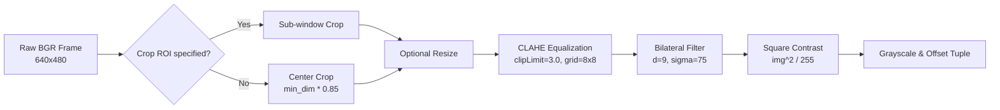

# Line Detection & Preprocessing Framework (`utils/line_detectors/detector.py`)

## 1. Overview & Supported Backends

[`utils/line_detectors/detector.py`](file:///d:/ai-sewing/utils/line_detectors/detector.py) serves as the primary computer vision engine for extracting line segments from video frames. It standardizes multiple detection backends into a unified `(N, 4)` float32 array representation:

$$\mathbf{L} = [[x_1, y_1, x_2, y_2]_1, \dots, [x_1, y_1, x_2, y_2]_N]$$

### Supported Backends (`DetectorMode`)
* **`DetectorMode.MLSD`** (Primary for arbitrary angle and non-ortho): Deep learning based Mobile-LSD model running via TensorRT (`TRTInfer`). Robust against fabric texture and shadows.
* **`DetectorMode.DEXINED`**: Deep extreme edge detection network generating boundary masks.
* **`DetectorMode.LSD`**: Line Segment Detector (`cv.createLineSegmentDetector`). Fast, sub-pixel accuracy, classical approach.
* **`DetectorMode.FLD`**: Fast Line Detector (`cv.ximgproc.createFastLineDetector`).
* **`DetectorMode.EDLINES`**: EdgeDrawing line detector (`cv.ximgproc.createEdgeDrawing`).
* **`DetectorMode.ENSEMBLE`**: Fuses LSD, FLD, and EDLines with mutual supporter scoring.

---

## 2. Preprocessing Architecture (`preprocessing_adjustor`)

The adjustor requires precise contrast normalization and texture suppression:



### Preprocessing Outputs
Returns `(gray, img, offset)` where `offset = (offset_x, offset_y, scale_x, scale_y)`:
* Tracks the exact 2D affine transformation from full camera frame coordinates to local ROI space.
* Allows detected lines inside the ROI to be mathematically projected back to full sensor coordinates.

---

## 3. Exclusion Zone & Mechanical Fixture Filtering

In sewing automation, fixed mechanical components (needle plate edges, screw holes, presser feet, feed dogs) produce persistent edge artifacts.

### 3.1 Mapping Sensor Space to Local ROI (`map_noisy_areas_to_roi`)
Exclusion zones are defined physically in original full-frame camera space (in centimeters). The system dynamically projects these zones into the local cropped/scaled ROI:

$$\begin{aligned}
x_{\text{roi, px}} &= \frac{x_{\text{center, px}} - \text{offset}_x}{\text{scale}_x} \\
y_{\text{roi, px}} &= \frac{y_{\text{center, px}} - \text{offset}_y}{\text{scale}_y}
\end{aligned}$$

### 3.2 Polygon Point-in-Polygon Rejection (`filter_noisy_lines_by_area`)
A candidate line segment is pruned if:
1. Its midpoint or endpoints fall inside an exclusion zone $[x_{\min}, x_{\max}] \times [y_{\min}, y_{\max}]$.
2. Its physical length is $\le \text{max\_length}$ (default: $1.5$ cm). True long fabric edges passing through the fixture zone are preserved.
3. Its orientation matches the specified axis filter (`'horizontal'` or `'vertical'`).

---

## 4. Dominant Angle Filtering (`filter_dominant_angles`)

Fabric boundaries typically align along one or two dominant directions, while internal creases and weave noise have erratic orientations.

```python
def filter_dominant_angles(
    lines: np.ndarray,
    num_bins: int = 72,
    top_k: int = 2,
    bin_threshold: float = 0.4,
    gradient_scores: Optional[np.ndarray] = None,
    length_weighting: bool = False,
    offset: Optional[Tuple[float, float, float, float]] = None,
) -> np.ndarray:
```

### Algorithmic Steps
1. **Orientation Mapping**: Angles are calculated modulo $180^\circ$:
   $$\theta = \operatorname{arctan2}(\Delta y, \Delta x) \pmod{180^\circ}$$
2. **Quality-Weighted Histogram**: Rather than simple counts, bins are weighted by segment length and Sobel edge gradient score:
   $$\text{Weight}_i = (\text{length}_i)^p \cdot S_{\text{grad}, i}$$
3. **Circular Boundary Wrapping**: Connects bin $0^\circ$ with bin $180^\circ$ via circular convolution to prevent boundary splitting of near-horizontal lines.
4. **Peak Selection**: Identifies top $K$ angular modes and retains only lines within $\pm \text{bandwidth}$ (default: $\pm 10^\circ$) of a dominant peak.

---

## 5. Collinear Line Merging (`merge_collinear_lines`)

Detectors frequently break continuous physical fabric edges into multiple broken segments. `merge_collinear_lines` consolidates collinear fragments:

1. **Compatibility Criteria**:
   Two segments $S_1, S_2$ are compatible if:
   * Angular difference $< \theta_{\text{thresh}}$ (e.g. $5^\circ$).
   * Perpendicular distance from endpoints of $S_2$ to line $S_1$ $< d_{\text{thresh}}$ (e.g. $3$ pixels).
   * Overlap or gap distance along the projection axis $< \text{gap}_{\text{thresh}}$.
2. **Consolidation**: Projects all points onto the principal line axis and constructs a single bounding segment spanning the extreme minimum and maximum endpoints.
