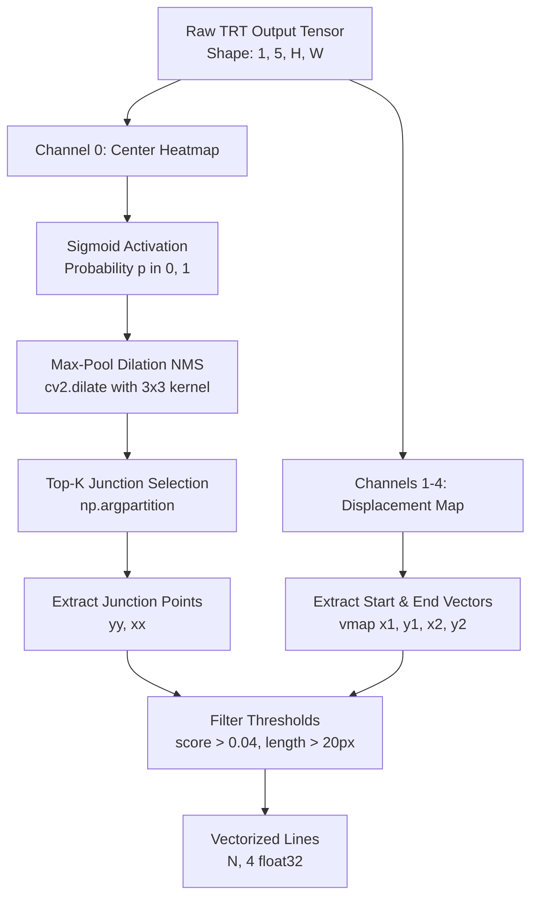

# Mobile-LSD Post-Processing (`utils/line_detectors/mlsd_postprocess.py`)

## 1. Overview & Role in the Vision Subsystem

[`utils/line_detectors/mlsd_postprocess.py`](file:///d:/ai-sewing/utils/line_detectors/mlsd_postprocess.py) contains the decoding algorithms required to convert raw output tensor feature maps from the **Mobile-LSD** (Mobile Line Segment Detector) deep neural network into discrete, vectorized line segment coordinates $(x_1, y_1, x_2, y_2)$.

Mobile-LSD predicts line segments using a continuous 2D heatmap representation combined with displacement vector fields, eliminating traditional combinatorial edge-linking heuristics.



---

## 2. Mathematical Heatmap Decoding (`deccode_output_score_and_ptss`)

```python
def deccode_output_score_and_ptss(tpMap: np.ndarray, topk_n: int = 200, ksize: int = 3):
```

### Tensor Layout
The input tensor `tpMap` has shape $(1, 5, H, W)$:
* **Channel 0 (`center`)**: Raw logits representing the likelihood that a pixel is a line segment center or junction.
* **Channels 1–2**: 2D offset vector $(\Delta x_1, \Delta y_1)$ from the center pixel to the segment start point.
* **Channels 3–4**: 2D offset vector $(\Delta x_2, \Delta y_2)$ from the center pixel to the segment end point.

### Decoding Algorithm
1. **Sigmoid Normalization**:
   Converts unconstrained center logits to normalized probabilities $P \in [0, 1]$:
   $$\text{Heat}(y, x) = \frac{1}{1 + \exp(-\text{center}(y, x))}$$

2. **Morphological Non-Maximum Suppression (NMS)**:
   Performs fast, GPU-friendly 2D local peak finding via grayscale dilation with a $3 \times 3$ flat structuring element:
   $$H_{\max} = \operatorname{dilate}(\text{Heat}, K_{3 \times 3})$$
   $$\text{KeepMask} = (\text{Heat} == H_{\max})$$
   $$\text{Heat}_{\text{suppressed}} = \text{Heat} \odot \text{KeepMask}$$

3. **Top-$K$ Peak Extraction**:
   Uses `np.argpartition` for efficient $O(N)$ extraction of the top $K$ junction candidates without sorting the entire array:
   $$\text{indices} = \operatorname{argpartition}(\text{Heat}_{\text{flat}}, -K)[-K:]$$
   Coordinates are unraveled into grid positions:
   $$y = \lfloor \text{index} / W \rfloor, \quad x = \text{index} \pmod W$$

---

## 3. Segment Reconstruction (`postprocess_mlsd_squares`)

```python
def postprocess_mlsd_squares(
    output_tensors: List[np.ndarray],
    img_shape: Tuple[int, int],
    input_shape: Tuple[int, int] = (512, 512),
    params: dict = {
        'score': 0.04,          # Confidence cutoff (lowered for fabric boundary sensitivity)
        'outside_ratio': 0.50,  # Tolerance for gaps before intersection
        'inside_ratio': 0.60,   # Internal overlap tolerance
        'w_overlap': 0.0,
        'w_degree': 1.95,
        'w_length': 0.0,
        'w_area': 1.86,
        'w_center': 0.14
    }
) -> np.ndarray:
```

### Parametric Filtering & Tuning for Fabric Inspection
1. **Confidence Threshold (`score: 0.04`)**:
   Lowered from default $0.06$ to accept faint or low-contrast boundary lines on dark or heavily textured fabrics.
2. **Minimum Euclidean Length (`distance > 20.0` pixels)**:
   Rejects short noise stubs and isolated texture points:
   $$\text{dist} = \sqrt{(x_2 - x_1)^2 + (y_2 - y_1)^2} > 20.0$$
3. **Coordinate Rescaling**:
   Transforms endpoint coordinates from network feature space ($512 \times 512$) back to image dimensions $(H_{\text{original}}, W_{\text{original}})$.
