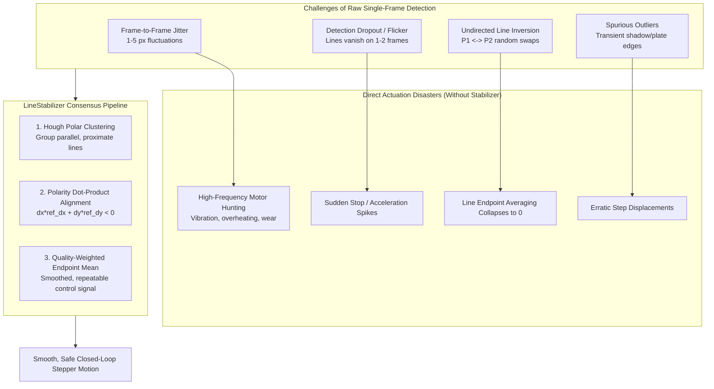
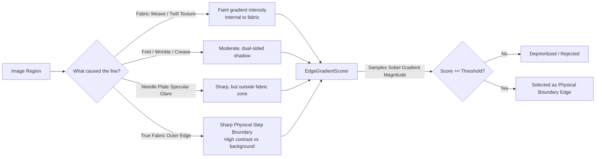

# Temporal Stabilization & Edge Gradient Saliency (`utils/tracking_helper.py`)

## 1. Why `LineStabilizer` Matters (The Engineering & Physical Necessity)

In automated robotic sewing, closed-loop visual servoing cannot act directly on raw single-frame line detections. Understanding why `LineStabilizer` is indispensable requires examining the physical dynamics of edge detection and motor control:



### 1.1 Mitigation of High-Frequency Mechanical Actuation
Video cameras at 30 FPS experience micro-variations due to sensor thermal noise, illumination flicker, and sub-pixel discretization. If raw line coordinates are converted directly to motor signals, the motors receive commands that oscillate back and forth by fractions of a millimeter every 33 ms. This causes:
* Severe audible motor humming and high-frequency mechanical vibration.
* Excessive stepper driver heating.
* False triggering of the mechanical moderation limit.
`LineStabilizer` serves as an intelligent temporal low-pass filter, delivering smooth, repeatable trajectory setpoints.

### 1.2 The "Undirected Line Segment" Inversion Problem
A mathematical line segment between points $\mathbf{p}_1$ and $\mathbf{p}_2$ is geometric and undirected. OpenCV and deep neural line detectors may arbitrarily report a line as $[x_1, y_1, x_2, y_2]$ in frame $k$, and flip it to $[x_2, y_2, x_1, y_1]$ in frame $k+1$.
* **The Disaster of Naive Averaging**: If you naively average these two frames:
  $$\frac{[x_1, y_1, x_2, y_2] + [x_2, y_2, x_1, y_1]}{2} = \left[\frac{x_1+x_2}{2}, \frac{y_1+y_2}{2}, \frac{x_1+x_2}{2}, \frac{y_1+y_2}{2}\right]$$
  The line collapses into a single collapsed point of length $0$!
* **How `LineStabilizer` Solves It**: Before averaging, it projects each candidate line's direction vector onto a reference vector via the 2D dot product. If $\Delta \mathbf{p} \cdot \Delta \mathbf{p}_{\text{ref}} < 0$, it automatically flips endpoints before computing the weighted mean.

### 1.3 Outlier Rejection via Hough Space Polar Clustering
Rather than blindly averaging all detections in the rolling buffer (which would pull the estimate toward spurious false-positive detections), `LineStabilizer` transforms all lines in the window into normal distance $\rho$ and orientation $\theta$:
$$\rho = x \cos\theta + y \sin\theta$$
Lines are clustered in $(\rho, \theta)$ space. The dominant consensus cluster with the highest number of votes is selected, discarding isolated transient ghosts.

---

## 2. Why `EdgeGradientScorer` Matters (The Saliency Necessity)

Geometric line detectors (LSD, FLD, EDLines) and deep models are purely mathematical feature extractors: they detect straight intensity changes without understanding what constitutes a **physical fabric boundary**.



### 2.1 The Challenge of Textile Materials
* **Internal Textures**: Twill denim, woven cotton, and knit fabrics contain strong internal parallel ridges that classical line detectors readily detect as long, straight lines.
* **Folds and Creases**: Material slack creates internal shadows that can be longer than the actual perimeter boundary.
* **Metallic Reflections**: The polished steel needle plate and presser foot produce specular glares that generate sharp false edges.

### 2.2 The Solution: Parametric Sobel Gradient Sampling
A genuine fabric perimeter edge is an abrupt physical boundary separating the dark/colored fabric from the calibrated sewing table background. It generates a powerful, continuous intensity step in the normal derivative.

`EdgeGradientScorer`:
1. Precomputes the normalized Sobel gradient magnitude field $\mathbf{G} = \sqrt{G_x^2 + G_y^2}$ across the entire ROI.
2. Parametrically walks $N = 20$ equidistant points along the line segment:
   $$\mathbf{p}(t) = \mathbf{p}_1 + t(\mathbf{p}_2 - \mathbf{p}_1), \quad t \in [0, 1]$$
3. Samples the physical gradient magnitude at each point and computes the mean:
   $$S_{\text{grad}} = \frac{1}{N} \sum_{i=1}^N \frac{\|\nabla I(\mathbf{p}(t_i))\|}{\max \|\nabla I\|}$$
4. Assigns each candidate line a normalized saliency score $S_{\text{grad}} \in [0.0, 1.0]$.
5. During corner selection, `_select_best_lines_gradient_priority` scales this score with $w_{\text{grad}} = 23.0$, guaranteeing that genuine fabric boundaries overpower internal weave patterns, even if an internal weave line happens to be longer!

---

## 3. Class API Reference

### `class LineStabilizer`

```python
class LineStabilizer:
    def __init__(
        self,
        window: int = 15,
        hough_d_thresh: float = 8.0,
        hough_theta_thresh: float = 0.08,
        min_cluster_ratio: float = 0.35,
    ):
```

#### Parameters
* `window`: Number of consecutive frames accumulated in the rolling buffer history (typically $15$ to $55$ frames).
* `hough_d_thresh`: Maximum normal distance difference $\Delta\rho$ (pixels) to group two lines into the same Hough cluster (default: $8.0$ px).
* `hough_theta_thresh`: Maximum angular difference $\Delta\theta$ (radians) to group lines into the same cluster (default: $0.08$ rad $\approx 4.6^\circ$).
* `min_cluster_ratio`: Minimum fraction of valid frames that must belong to the dominant cluster (default: $0.35$).

#### Core Methods
* **`update(h_line, v_line, h_weight=1.0, v_weight=1.0) -> Tuple[Optional[List[float]], Optional[List[float]]]`**:
  Ingests new line candidates and returns stabilized $[x_1, y_1, x_2, y_2]$ coordinates for horizontal and vertical edges. Returns `(None, None)` during warmup ($< \text{window}$ frames).
* **`reset() -> None`**:
  Flushes all rolling history queues (used when transitioning between alignment phases or after motor motions).

---

### `class EdgeGradientScorer`

```python
class EdgeGradientScorer:
    def __init__(
        self,
        ksize: int = 3,
        n_samples: int = 20,
        normalize: bool = True,
    ):
```

#### Parameters
* `ksize`: Sobel operator aperture kernel size ($3$ by default).
* `n_samples`: Number of discrete sampling points along the line segment ($20$ by default).
* `normalize`: Binds output scores within $[0.0, 1.0]$ relative to peak image gradient.

#### Core Methods
* **`precompute(gray: np.ndarray) -> None`**:
  Computes and caches the full 2D gradient magnitude map $\mathbf{G}_{H \times W}$. Called once per video frame before scoring candidate lines.
* **`score_lines(lines: np.ndarray) -> np.ndarray`**:
  Takes an $(N, 4)$ array of line segments and returns a 1D NumPy array of shape $(N,)$ with float64 edge saliency scores.
