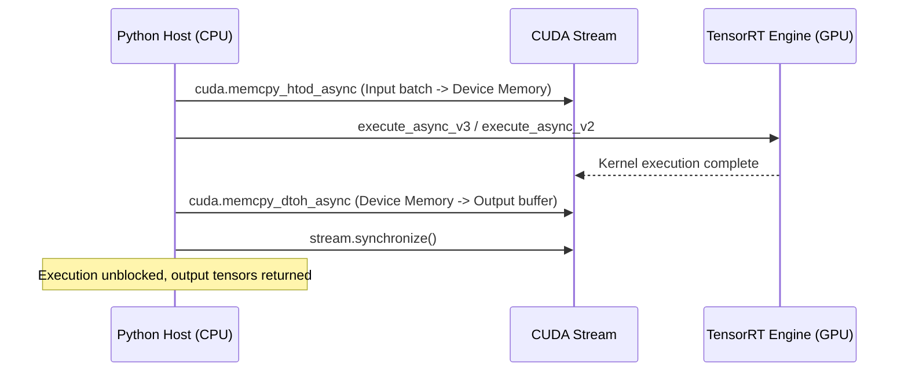

# TensorRT Accelerated Inference (`utils/line_detectors/trt_infer.py`)

## 1. Overview & Acceleration Role

[`utils/line_detectors/trt_infer.py`](file:///d:/ai-sewing/utils/line_detectors/trt_infer.py) encapsulates NVIDIA TensorRT and PyCUDA execution for deep neural network backends (Mobile-LSD and DexiNed).

Running deep neural networks on edge devices (such as the NVIDIA Jetson Nano / Orin) with standard PyTorch or ONNXRuntime often introduces latencies $> 100$ ms per frame. `TRTInfer` optimizes execution using FP16 TensorRT serialized engines, delivering sub-20 ms inference times essential for real-time visual servoing.



---

## 2. Dual API Architecture (TensorRT 10+ vs Legacy TRT)

TensorRT 10 introduced breaking API changes (deprecating `num_bindings`, `get_binding_name`, `execute_async_v2` in favor of tensor-based APIs). `TRTInfer` dynamically adapts at runtime to ensure compatibility across older JetPack releases (JetPack 4.x/5.x) and modern JetPack 6.x / desktop CUDA environments:

### Dynamic API Detection

```python
if hasattr(self.engine, 'num_io_tensors'):
    # --- Modern TensorRT 10+ Protocol ---
    for i in range(self.engine.num_io_tensors):
        name = self.engine.get_tensor_name(i)
        shape = self.engine.get_tensor_shape(name)
        mode = self.engine.get_tensor_mode(name)
        # Allocate page-locked device memory via PyCUDA
        device_mem = cuda.mem_alloc(max_size)
        if mode == trt.TensorIOMode.INPUT:
            self.d_input = device_mem
            self.input_name = name
        else:
            self.d_outputs.append(device_mem)
            self.output_names.append(name)
else:
    # --- Legacy TensorRT 8.x Protocol ---
    for i in range(self.engine.num_bindings):
        name = self.engine.get_binding_name(i)
        shape = self.engine.get_binding_shape(i)
        is_input = self.engine.binding_is_input(i)
        ...
```

---

## 3. Asynchronous Execution Pipeline (`infer`)

```python
def infer(self, batch: np.ndarray) -> List[np.ndarray]:
```

### Operational Steps
1. **Input Batch Validation & Flattening**:
   Ensures input batch size $\le \text{max\_batch\_size}$ and ensures contiguous float32 memory layout (`np.ascontiguousarray`).
2. **Host-to-Device Transfer (`H2D`)**:
   Asynchronously queues memory transfer from CPU RAM to GPU device memory over `self.stream`:
   ```python
   cuda.memcpy_htod_async(self.d_input, batch, self.stream)
   ```
3. **Asynchronous Kernel Execution**:
   * **TRT 10+**: Binds input and output addresses using `set_tensor_address(name, ptr)` and triggers `execute_async_v3(self.stream.handle)`.
   * **Legacy TRT**: Binds device pointers using `bindings` list and triggers `execute_async_v2(bindings, self.stream.handle)`.
4. **Device-to-Host Transfer (`D2H`)**:
   Asynchronously queues transfer of output feature maps back to pre-allocated host buffers.
5. **Stream Synchronization**:
   Calls `self.stream.synchronize()` to pause Python thread execution only until all GPU kernels and transfers on this stream have fully completed.
